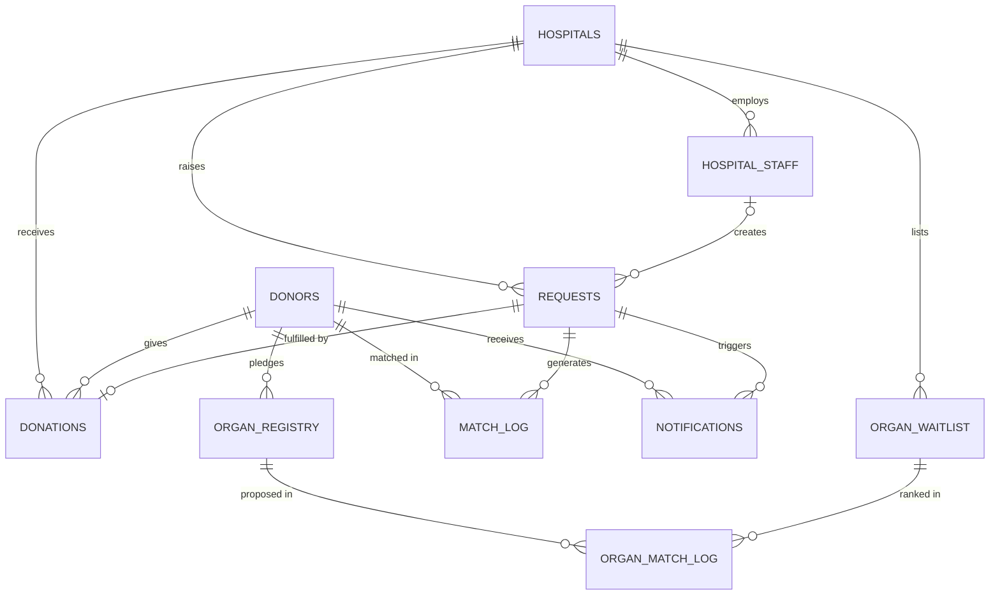

# Pulse — Blood/Organ Donor Real-Time Availability Network

**Requirements & Design Document** · DBMS Lab Mini Project · v2 (expanded scope)

**What changed in v2:** six features moved from "future scope" into the project: real notifications, distance-based matching, role-based authorisation with an admin role, a donor profile with eligibility countdown, scheduled eligibility restore, and organ matching with compatibility and waiting-list priority.

---

# Part 1 — Requirements

## 1.1 Problem Statement

When a patient urgently needs blood or an organ, hospitals usually rely on phone calls and personal contacts to find donors. Existing donor apps are mostly static directories: they don't know whether a donor is eligible right now (a blood donor must wait 90 days between donations), they don't rank donors by how close they are, and they don't tell donors when they're needed.

**Pulse** is a database-driven system that tracks donor eligibility automatically, matches nearby eligible donors to critical blood requests inside the database, notifies them, and ranks organ recipients by compatibility and waiting-list priority.

## 1.2 Goals

- Secure accounts for donors, hospital staff, and administrators, each with only the permissions they need.
- Hospitals raise blood or organ requests with an urgency level.
- Critical blood requests are matched automatically to eligible donors, nearest first.
- Matched donors are notified by email and, optionally, SMS.
- Eligibility (90-day cooldown) is enforced and restored automatically on a schedule.
- Donors see their own status, countdown, history, and matches in a profile page.
- Organ pledges are matched to waiting-list patients by blood-group compatibility and a priority score.
- Keep the "smart" logic inside the database (triggers, functions, views, scheduled jobs), since this is a DBMS lab project.

## 1.3 User Roles

| Role | Created by | Purpose |
|---|---|---|
| **Donor** | Public sign-up | Manage own profile, respond to matches, pledge organs |
| **Hospital Staff** | Public sign-up, linked to one hospital | Raise requests, log donations, manage the organ waiting list for their hospital |
| **Admin** | Seed script only (no public sign-up) | Verify hospitals, manage users, view audit log, run jobs |

## 1.4 Functional Requirements

### Accounts and access

| ID | Requirement |
|---|---|
| FR-1 | A donor signs up with name, email, password, phone, blood type, city, and location (browser geolocation or manual entry). |
| FR-2 | A staff member signs up by choosing a hospital, with name, email, password, and role/title. |
| FR-3 | Users sign in with email + password and stay signed in across page refreshes. |
| FR-4 | Passwords are stored only as bcrypt hashes; the hash is never returned by any API. |
| FR-5 | Every protected API route declares which roles may call it; other roles receive `403`. |
| FR-6 | Staff may act only on their own hospital's data (requests, donations, waiting list). |
| FR-7 | Admin accounts are created by a seed script, never through public sign-up. |
| FR-8 | An admin verifies hospitals. Staff of an unverified hospital can sign in but cannot raise requests or list patients. |
| FR-9 | An admin can deactivate a user; deactivated users cannot sign in. |
| FR-10 | Sensitive actions (request created, donation logged, hospital verified, user deactivated, organ match confirmed) are written to an audit log that admins can view. |

### Blood requests and matching

| ID | Requirement |
|---|---|
| FR-11 | Staff create a request: patient name, type (Blood/Organ), blood type or organ type, urgency (Critical/Moderate/Low), and search radius (default 50 km). |
| FR-12 | When a **Critical Blood** request is created, the database automatically finds up to 10 eligible donors with the matching blood type within the radius, ranked by distance, then by longest time since last donation, and records them in `match_log` with their distance. |
| FR-13 | If a donor or hospital has no coordinates, matching falls back to same-city. |
| FR-14 | Staff can view the donors matched to their hospital's requests. |
| FR-15 | A matched donor can accept or decline from their profile; the response is stored on the match. |

### Donations and eligibility

| ID | Requirement |
|---|---|
| FR-16 | Staff log a completed donation against a donor and, optionally, a request. |
| FR-17 | Logging a blood donation automatically records the donation date, marks the donor ineligible, and marks the linked request fulfilled. |
| FR-18 | A scheduled job runs daily at midnight and restores eligibility for donors whose last donation was 90+ days ago. |

### Location

| ID | Requirement |
|---|---|
| FR-19 | Donors and hospitals store latitude and longitude. Distance is computed in the database with the Haversine formula. |
| FR-20 | Donors never see other donors' locations; staff see only the distance, not coordinates. |

### Notifications

| ID | Requirement |
|---|---|
| FR-21 | When a donor is matched to a request, the database queues a notification for each channel the donor has enabled (email, SMS). |
| FR-22 | A background worker sends queued notifications, records `SENT` or `FAILED`, retries up to 3 times, and never blocks request creation. |
| FR-23 | When a donor becomes eligible again, a notification is queued. |
| FR-24 | Donors can switch email and SMS notifications on or off in their profile. |

### Donor profile

| ID | Requirement |
|---|---|
| FR-25 | A profile page shows eligibility status, last donation date, next eligible date, days remaining, and a countdown visual. |
| FR-26 | The profile also lists donation history, matches received (with accept/decline), organ pledges, and lets the donor edit contact details, location, and notification preferences. |

### Organ matching

| ID | Requirement |
|---|---|
| FR-27 | A donor can pledge one or more organs and withdraw a pledge. |
| FR-28 | Staff add a patient to their hospital's organ waiting list: patient name, organ needed, blood group, urgency score 1–10. |
| FR-29 | Matching a pledged organ returns only waiting patients who need that organ and are ABO blood-group compatible (looked up in a compatibility table). |
| FR-30 | Compatible patients are ranked by a priority score combining urgency, days on the waiting list, and distance. The top 5 are stored as proposals. |
| FR-31 | Staff or admin confirm one proposal. The pledge and the patient are marked matched, and the other proposals are rejected. |

### Dashboards

| ID | Requirement |
|---|---|
| FR-32 | Staff dashboard: open critical requests with days open, eligible donor count, waiting-list size. |
| FR-33 | Admin dashboard: user counts, unverified hospitals, notification queue health (pending/failed), recent audit entries. |

## 1.5 Non-Functional Requirements

| ID | Requirement |
|---|---|
| NFR-1 | **Integrity** — foreign keys and CHECK constraints reject invalid data (unknown hospital, bad blood type, urgency score outside 1–10, latitude outside −90..90). |
| NFR-2 | **Security** — bcrypt hashes, signed JWTs with expiry, parameterised SQL, secrets only in `.env`. |
| NFR-3 | **Consistency** — matching, eligibility, and priority rules live in the database so every client gets identical results. |
| NFR-4 | **Privacy** — donor phone/email visible only to staff for donors matched to their hospital's request, and to admins; exact coordinates never leave the server. |
| NFR-5 | **Reliability** — notifications use a queue with retries; a failed email or SMS never fails the request that triggered it. |
| NFR-6 | **Auditability** — all sensitive actions leave an audit row with actor, action, and time. |
| NFR-7 | **Usability** — clear loading and error states; the UI never crashes if the backend is unreachable. |
| NFR-8 | **Normalisation** — schema is in 3NF. |
| NFR-9 | **Portability** — runs locally on Windows with free tools only; notification provider defaults to a console/test mode so no paid account is needed. |

## 1.6 System Requirements & Tools

| Layer | Tools |
|---|---|
| Database | PostgreSQL, PL/pgSQL, pgAdmin 4, `pg_cron` (Linux/Docker/managed hosts) |
| Backend | Node.js, Express, `pg`, `bcrypt`, `jsonwebtoken`, `dotenv`, `cors`, `nodemailer` (email), `twilio` (optional SMS), `node-cron` (scheduler fallback) |
| Frontend | React (Vite), React Router, plain CSS or Tailwind CSS, browser Geolocation API |
| Testing providers | Mailtrap or Ethereal for email; console provider for SMS |
| Other | VS Code, Postman/curl, Git & GitHub |

## 1.7 Assumptions & Limitations

- **Notifications:** real delivery needs provider accounts. Email uses SMTP (Mailtrap/Ethereal for testing). SMS uses Twilio; trial accounts only reach verified numbers, and commercial SMS in India needs DLT registration, so SMS is optional and the demo can run in console mode.
- **Scheduler:** `pg_cron` is not bundled with the standard Windows PostgreSQL installer. On Windows, the same function is called by a `node-cron` job in the backend.
- **Location:** coordinates come from the browser or manual entry; there is no street-level geocoding requirement.
- **Organ matching is a simplified academic model.** It uses ABO compatibility and a weighted priority score. Real organ allocation is regulated (in India, THOA 1994 and NOTTO) and uses many more clinical criteria such as HLA matching, organ size, and disease-severity scores. This project is not a clinical system.
- Rh factor is used for blood transfusion matching (exact type) but ignored for organ compatibility, where ABO is the main barrier.
- JWTs are kept in browser storage for simplicity; httpOnly cookies and refresh tokens are future work.

---

# Part 2 — Design

## 2.1 Architecture

```
┌──────────────┐  HTTP/JSON   ┌───────────────┐   SQL    ┌──────────────────────────┐
│ React (Vite) │ ───────────► │ Express API   │ ───────► │ PostgreSQL               │
│  :5173       │ ◄─────────── │  :5000        │ ◄─────── │  tables, triggers,       │
│  role-based  │ JWT in header│  auth + RBAC  │          │  functions, views,       │
│  UI          │              └───────┬───────┘          │  pg_cron jobs            │
└──────────────┘                      │ node-cron        └────────────▲─────────────┘
                              ┌───────▼───────┐   polls notifications │
                              │ Notifier      │ ──────────────────────┘
                              │ worker (Node) │ ── SMTP ──► Email
                              └───────────────┘ ── Twilio ─► SMS
```

**Design principle:** the API stays thin. Matching, eligibility, notification queueing, organ ranking, and status changes happen in database triggers and functions. The only logic outside the database is sending messages, because a database can't talk to an SMTP server.

## 2.2 Database Design

### Entities and relationships



`ADMINS`, `AUDIT_LOG`, and `ABO_COMPATIBILITY` are standalone: admins and the audit log reference actors by role and id, and the compatibility table is a lookup.

### Relational schema

Primary keys are underlined in the lab diagram; foreign keys marked `→`. **New** or *changed* items are flagged.

- **HOSPITALS**(hospital_id, name, city, phone, license_no, *latitude*, *longitude*, *verified*)
- **HOSPITAL_STAFF**(staff_id, hospital_id→HOSPITALS, name, role, phone, email, password_hash, *is_active*)
- **DONORS**(donor_id, name, phone, email_login, blood_type, dob, gender, city, *latitude*, *longitude*, last_donation_date, eligible_status, registered_on, password_hash, *notify_email*, *notify_sms*, *is_active*)
- **ADMINS** *(new)* (admin_id, name, email, password_hash, created_on)
- **REQUESTS**(request_id, hospital_id→HOSPITALS, staff_id→HOSPITAL_STAFF, request_type, blood_type_needed, organ_type_needed, units_needed, urgency, *radius_km*, patient_name, requested_on, status)
- **MATCH_LOG**(match_id, request_id→REQUESTS, donor_id→DONORS, matched_on, *distance_km*, contacted_status, *responded_on*)
- **DONATIONS**(donation_id, donor_id→DONORS, request_id→REQUESTS, hospital_id→HOSPITALS, donation_type, units, donated_on)
- **NOTIFICATIONS** *(new)* (notification_id, donor_id→DONORS, request_id→REQUESTS, type, channel, subject, message, status, attempts, created_at, sent_at)
- **ORGAN_REGISTRY**(organ_id, donor_id→DONORS, organ_type, registered_on, status)
- **ORGAN_WAITLIST** *(new)* (waitlist_id, hospital_id→HOSPITALS, staff_id→HOSPITAL_STAFF, patient_name, organ_type, blood_group, urgency_score, listed_on, status)
- **ORGAN_MATCH_LOG** *(new)* (organ_match_id, organ_id→ORGAN_REGISTRY, waitlist_id→ORGAN_WAITLIST, priority_score, distance_km, rank, matched_on, status)
- **ABO_COMPATIBILITY** *(new)* (donor_abo, recipient_abo) — composite primary key, 9 rows
- **AUDIT_LOG** *(new)* (log_id, actor_role, actor_id, action, entity, entity_id, created_at)

### Key constraints

| Table.column | Constraint |
|---|---|
| donors.blood_type | one of A+, A-, B+, B-, AB+, AB-, O+, O-; `blood_group` in the waitlist is one of A, B, AB, O |
| donors.eligible_status | `'Y'` or `'N'`, default `'Y'` |
| donors.email_login, hospital_staff.email, admins.email | UNIQUE |
| latitude / longitude | −90..90 / −180..180 (NULL allowed) |
| hospitals.verified | boolean, default false |
| requests.request_type | `BLOOD` or `ORGAN` |
| requests.urgency | `CRITICAL`, `MODERATE`, `LOW` |
| requests.radius_km | 1..500, default 50 |
| requests.status | `OPEN`, `MATCHED`, `FULFILLED`, `CANCELLED` |
| match_log.contacted_status | `PENDING`, `CONTACTED`, `ACCEPTED`, `DECLINED` |
| notifications.channel | `EMAIL` or `SMS` |
| notifications.status | `PENDING`, `SENT`, `FAILED` |
| notifications.type | `MATCH`, `ELIGIBLE_AGAIN` |
| organ_waitlist.urgency_score | 1..10 |
| organ_waitlist.status | `WAITING`, `MATCHED`, `TRANSPLANTED`, `REMOVED` |
| organ_registry.status | `AVAILABLE`, `MATCHED`, `DONATED`, `WITHDRAWN` |
| organ_match_log.status | `PROPOSED`, `ACCEPTED`, `REJECTED` |

### Database logic

| Object | Type | Purpose |
|---|---|---|
| `haversine_km(lat1, lon1, lat2, lon2)` | Function | Great-circle distance in km; returns NULL if any input is NULL. |
| `find_matching_donors(request_id)` | Function | Eligible donors of the needed blood type within `radius_km`, ranked by distance then days since last donation; same-city fallback when coordinates are missing; inserts up to 10 into `match_log` with `distance_km`; sets request `MATCHED`. |
| `trg_critical_request` | Trigger on `requests` (AFTER INSERT) | Critical + Blood → calls `find_matching_donors`. |
| `trg_after_match` | Trigger on `match_log` (AFTER INSERT) | Inserts one `NOTIFICATIONS` row per channel the donor has enabled. |
| `trg_after_donation` | Trigger on `donations` (AFTER INSERT) | Blood donation → donor `eligible_status = 'N'`, set last donation date, mark request `FULFILLED`. |
| `restore_donor_eligibility()` | Function | Restores donors 90+ days past their last donation, queues `ELIGIBLE_AGAIN` notifications, returns the count. |
| `cron.schedule('restore_donor_eligibility', '0 0 * * *', ...)` | `pg_cron` job | Runs the function daily at midnight (Windows: `node-cron` calls it instead). |
| `organ_priority(waitlist_id, distance_km)` | Function | Returns the priority score (formula below). |
| `match_organ(organ_id)` | Function | Finds `WAITING` patients who need that organ and whose blood group is ABO-compatible with the donor; scores and ranks them; stores the top 5 in `organ_match_log` as `PROPOSED`. |
| `confirm_organ_match(organ_match_id)` | Function | Marks the chosen proposal `ACCEPTED`, the pledge `MATCHED`, the patient `MATCHED`, and the other proposals `REJECTED`. |
| `trg_audit_*` | Triggers on `requests`, `donations`, `hospitals` (verified change), `organ_match_log` | Write rows to `audit_log`. API writes the rest (user deactivation, logins by admins). |
| `vw_donor_eligibility` | View | Per donor: `next_eligible_date`, `days_remaining` (never below 0), `is_eligible`. Powers the countdown. |
| `vw_critical_open_requests` | View | Open critical requests with hospital name and days open. |
| `vw_eligible_donors` | View | Donors currently eligible and active. |
| `vw_waitlist_ranked` | View | Waiting patients with days waiting, for the staff waiting-list page. |

### Distance and ranking formulas

```
Haversine:  a = sin²(Δlat/2) + cos(lat1)·cos(lat2)·sin²(Δlon/2)
            distance_km = 2 · 6371 · asin(√a)

Blood match order:  distance_km ASC, last_donation_date ASC NULLS FIRST

Organ priority (0–100, higher is first):
   urgency_norm   = urgency_score × 10                      (10–100)
   waiting_norm   = MIN(days_waiting, 365) / 365 × 100
   proximity_norm = MAX(0, 100 − distance_km / 5)           (0 at 500 km)
   priority       = 0.5·urgency_norm + 0.3·waiting_norm + 0.2·proximity_norm
```

The weights (0.5 / 0.3 / 0.2) are constants in one function so they can be changed in one place.

### ABO compatibility table

| Donor group | Can give to |
|---|---|
| O | O, A, B, AB |
| A | A, AB |
| B | B, AB |
| AB | AB |

### Core workflows

**Blood request**

```
Staff of a verified hospital creates CRITICAL BLOOD request
        │  INSERT INTO requests
        ▼
trg_critical_request → find_matching_donors()
   eligible + same blood type + within radius, nearest first
   → INSERT up to 10 rows into match_log (with distance_km)
   → requests.status = 'MATCHED'
        ▼
trg_after_match → INSERT notification rows (EMAIL / SMS per donor preference)
        ▼
Notifier worker sends them → status SENT or FAILED (3 retries)
        ▼
Donor opens profile → ACCEPTED / DECLINED
        ▼
Donation happens → INSERT INTO donations
        ▼
trg_after_donation → donor ineligible, request FULFILLED
        ▼
Midnight job after day 90 → restore_donor_eligibility()
   → eligible again + ELIGIBLE_AGAIN notification
```

**Organ matching**

```
Donor pledges organ (ORGAN_REGISTRY: AVAILABLE)
Staff add patients to ORGAN_WAITLIST (WAITING)
        ▼
Staff/admin press "Find recipients" on a pledge → match_organ(organ_id)
   same organ + ABO-compatible + WAITING → score → top 5 PROPOSED
        ▼
Staff review ranked list → confirm_organ_match()
   pledge MATCHED · patient MATCHED · others REJECTED · audit row written
```

Organ matching is deliberately manual to start: a person confirms every proposal.

## 2.3 Backend / API Design

Base URL: `http://localhost:5000/api`

### Permission matrix

| Capability | Donor | Staff (own hospital) | Admin |
|---|---|---|---|
| Sign up / sign in | ✔ | ✔ | sign in only |
| View own profile, countdown, history | ✔ | – | – |
| Edit own profile, location, notification preferences | ✔ | – | – |
| Respond to a match | ✔ (own) | – | – |
| Pledge / withdraw organ | ✔ (own) | – | – |
| Raise / cancel requests | – | ✔ (verified hospital) | ✔ |
| View matches for a request | – | ✔ | ✔ |
| Log donations | – | ✔ | ✔ |
| View eligible donor list | – | ✔ | ✔ |
| Manage organ waiting list | – | ✔ | ✔ |
| Run organ matching, confirm proposal | – | ✔ | ✔ |
| Verify hospitals, deactivate users | – | – | ✔ |
| View audit log, notification health | – | – | ✔ |
| Run eligibility restore manually | – | – | ✔ |

### Routes

| Method | Route | Roles | Description |
|---|---|---|---|
| POST | `/auth/signup` | Public | Create donor or staff account; returns JWT + user. |
| POST | `/auth/login` | Public | Sign in as `DONOR`, `STAFF`, or `ADMIN`. |
| GET | `/auth/me` | Any signed-in | Current user from token. |
| GET | `/hospitals` | Public | Hospital list for the staff sign-up dropdown. |
| PATCH | `/hospitals/:id/verify` | Admin | Set verified true/false. |
| GET | `/donors/me` | Donor | Profile plus eligibility countdown (from `vw_donor_eligibility`). |
| PUT | `/donors/me` | Donor | Update contact details, location, notification preferences. |
| GET | `/donors/me/donations` | Donor | Donation history. |
| GET | `/donors/me/matches` | Donor | Matches received. |
| POST | `/matches/:id/respond` | Donor | Body `{ response: "ACCEPTED" \| "DECLINED" }`. |
| GET | `/donors/eligible` | Staff, Admin | Eligible donors (view). |
| POST | `/requests` | Staff, Admin | Create request (trigger handles matching). |
| GET | `/requests` | Staff (own), Admin | List requests. |
| GET | `/requests/critical` | Staff, Admin | Open critical requests (view). |
| GET | `/requests/:id/matches` | Staff (own), Admin | Matched donors with distance. |
| PATCH | `/requests/:id/cancel` | Staff (own), Admin | Cancel a request. |
| POST | `/donations` | Staff, Admin | Log a donation (trigger updates eligibility). |
| GET | `/notifications/me` | Donor | Own notifications. |
| POST | `/organs/pledges` | Donor | Pledge an organ. |
| DELETE | `/organs/pledges/:id` | Donor | Withdraw a pledge. |
| POST | `/organs/waitlist` | Staff | Add a patient to the waiting list. |
| GET | `/organs/waitlist` | Staff (own), Admin | Ranked waiting list. |
| POST | `/organs/pledges/:id/match` | Staff, Admin | Run `match_organ`; returns ranked proposals. |
| POST | `/organs/matches/:id/confirm` | Staff, Admin | Run `confirm_organ_match`. |
| GET | `/admin/stats` | Admin | Dashboard numbers. |
| GET | `/admin/users` | Admin | Users by role. |
| PATCH | `/admin/users/:role/:id/active` | Admin | Activate/deactivate. |
| GET | `/admin/audit` | Admin | Audit log. |
| GET | `/admin/notifications` | Admin | Queue health (pending/failed counts, recent failures). |
| POST | `/admin/jobs/restore-eligibility` | Admin | Run the restore function now. |
| GET | `/health` | Public | Health check. |

### Authentication and authorisation

1. **Sign up:** validate → `bcrypt.hash(password, 10)` → insert → sign JWT `{ id, role, name, hospital_id? }`, 7-day expiry.
2. **Sign in:** look up by role + email → reject inactive users → `bcrypt.compare` → return JWT. Same error for unknown email and wrong password.
3. **`requireAuth`** middleware verifies the bearer token and sets `req.user`.
4. **`requireRole(...roles)`** middleware returns `403` if the role isn't allowed.
5. **Ownership checks** compare `req.user.hospital_id` with the row's `hospital_id` for staff.
6. **`requireVerifiedHospital`** blocks staff of unverified hospitals from creating requests or waiting-list entries.
7. **Admins** are inserted by `npm run seed:admin`.

### Notification worker design

- Runs in the backend process (or as its own `node notifier.js`) every 30 seconds.
- Selects up to 20 rows where `status = 'PENDING'` using `FOR UPDATE SKIP LOCKED`, so two workers never send the same message.
- Provider chosen by `NOTIFY_PROVIDER`: `console` (prints), `smtp` (Nodemailer), or `twilio`.
- Success → `SENT` with `sent_at`. Failure → `attempts + 1`; after 3 attempts → `FAILED`.
- Message text never includes the requesting patient's name, only blood type, hospital name, city, and approximate distance.

### Environment variables

`DB_USER`, `DB_PASSWORD`, `DB_HOST`, `DB_PORT`, `DB_NAME`, `JWT_SECRET`, `PORT`, `NOTIFY_PROVIDER`, `SMTP_HOST`, `SMTP_PORT`, `SMTP_USER`, `SMTP_PASS`, `TWILIO_SID`, `TWILIO_TOKEN`, `TWILIO_FROM`

## 2.4 Frontend Design

### Page map

| Route | Page | Roles |
|---|---|---|
| `/auth` | Sign In / Sign Up (mode tabs + Donor/Staff toggle; small "Admin sign in" link) | Signed-out |
| `/` | Dashboard (content depends on role) | All |
| `/profile` | Donor profile: eligibility countdown, history, matches, preferences, location | Donor |
| `/organ-pledges` | Pledge and withdraw organs | Donor |
| `/requests` | Create request + matched donors with distance | Staff |
| `/donations` | Log a donation | Staff |
| `/donors` | Eligible donors list | Staff |
| `/organ-waitlist` | Add patients, ranked waiting list | Staff |
| `/organ-matching` | Pick a pledge, run matching, review ranked proposals, confirm | Staff, Admin |
| `/admin` | Stats, queue health, recent audit entries | Admin |
| `/admin/hospitals` | Verify hospitals | Admin |
| `/admin/users` | Activate/deactivate users | Admin |
| `/admin/audit` | Full audit log | Admin |

### Behaviour

- The sidebar shows only the links the role may use; a `RoleRoute` component redirects anyone who types a forbidden URL.
- Sign-up fields change by role. Donors get a "Use my location" button (browser Geolocation) with manual fallback.
- **Eligibility countdown:** a ring showing days remaining out of 90. Eligible donors see "Eligible now" in teal; ineligible donors see the days left and the next eligible date. Coral is never used here, because it is reserved for critical requests.
- After a Critical Blood request is submitted, the UI fetches `/requests/:id/matches` and lists donors with distance in km.
- Matches on the donor profile have Accept / Decline buttons.
- The organ matching page shows each proposal's rank, score breakdown (urgency, waiting, proximity), and a Confirm button.
- Every page has loading and error states.

### Visual design

| Token | Value | Use |
|---|---|---|
| Ink | `#0B2B2C` | Text, sidebar |
| Primary teal | `#0F6E56` | Buttons, eligible/OK states, countdown |
| Alert coral | `#E0664A` | **Only** critical/urgent states |
| Background | `#F6F4EE` | Page background |
| Headings font | Space Grotesk | |
| Body font | Inter | |

## 2.5 Security Considerations

- Passwords hashed with bcrypt; plain text never stored or logged; `password_hash` never returned.
- Role checks and hospital-ownership checks on every protected route (not only in the UI).
- Parameterised SQL (`$1, $2, ...`) everywhere.
- Secrets and provider keys only in `.env` (git-ignored).
- Privacy: donor contact details are exposed only to staff of the matching hospital and to admins; coordinates are used for distance only.
- Audit log for sensitive actions.
- **Known limitations:** JWT in browser storage (XSS risk), no rate limiting on login, no refresh tokens or token revocation beyond the user's `is_active` flag.

## 2.6 Testing Plan

| # | Test | Expected |
|---|---|---|
| T1 | Insert request with non-existent `hospital_id` | Rejected by foreign key |
| T2 | Insert donor with blood type `X+` | Rejected by CHECK |
| T3 | Create CRITICAL BLOOD request with eligible donors nearby | `match_log` populated, request `MATCHED` |
| T4 | Insert a blood donation | Donor `eligible_status = 'N'`, linked request `FULFILLED` |
| T5 | Sign up twice with the same email | 409 conflict |
| T6 | Log in with wrong password | 401 |
| T7 | Call a protected route without a token | 401 |
| T8 | Donor calls `POST /requests` | 403 |
| T9 | Staff of hospital A reads matches for hospital B's request | 403 |
| T10 | Staff of an unverified hospital creates a request | 403 |
| T11 | Non-admin calls any `/admin/*` route | 403 |
| T12 | Deactivated user tries to sign in | Rejected |
| T13 | Donors at 10 km and 40 km are matched in that order; one at 200 km is excluded with radius 50 | Correct order and exclusion |
| T14 | Donor with no coordinates | Matched by same city; `distance_km` is NULL |
| T15 | `match_log` insert for a donor with only email enabled | One notification row (EMAIL) |
| T16 | Worker sends a pending notification | Status `SENT`, `sent_at` set |
| T17 | Provider forced to fail | `attempts` increments; `FAILED` after 3 |
| T18 | Request creation while the notifier is stopped | Request still succeeds; notifications stay `PENDING` |
| T19 | `GET /donors/me` for a donor who donated 30 days ago | `days_remaining = 60` |
| T20 | Set last donation 91 days back, run `restore_donor_eligibility()` | Donor eligible again; `ELIGIBLE_AGAIN` notification queued |
| T21 | Scheduled job fires at midnight (pg_cron or node-cron) | Same result as T20 without manual call |
| T22 | Donor responds ACCEPTED to a match | `contacted_status = 'ACCEPTED'`, `responded_on` set |
| T23 | Match an A+ donor's kidney; waitlist has A, AB, B, O patients | Only A and AB patients proposed |
| T24 | Two compatible patients, urgency 9 (waiting 10 days) vs urgency 5 (waiting 300 days) | Higher priority score ranks first per formula; scores shown |
| T25 | Equal urgency and distance, different waiting time | Longer-waiting patient ranks first |
| T26 | Confirm one proposal | Pledge and patient `MATCHED`; other proposals `REJECTED`; audit row written |
| T27 | Withdraw a pledge that has pending proposals | Proposals rejected; pledge `WITHDRAWN` |

## 2.7 Build Order

| Phase | Work | Priority |
|---|---|---|
| 1 | Core schema, blood matching, donations, eligibility trigger, basic auth, dashboard | Must |
| 2 | RBAC middleware, admin role, hospital verification, audit log | Must |
| 3 | Donor profile + `vw_donor_eligibility` countdown + accept/decline | Must |
| 4 | Coordinates, Haversine, distance-ranked matching with city fallback | Should |
| 5 | Notification queue, trigger, worker (console + email), scheduler job | Should |
| 6 | Organ waiting list, ABO table, priority score, match and confirm | Should |
| 7 | SMS via Twilio, admin stats and queue-health page | Stretch |

If time is short, finish phases 1–3 first, since they make the system complete end to end, and add the rest in order.

## 2.8 Future Scope

- PostGIS and spatial indexes for large datasets.
- Clinical organ allocation criteria (HLA, organ size, disease-severity scores) and integration with the national registry.
- Push notifications and a mobile app.
- httpOnly cookies, refresh tokens, login rate limiting, two-factor authentication.
- Multilingual interface.
- Analytics: response time per donor, fulfilment rate per hospital.
